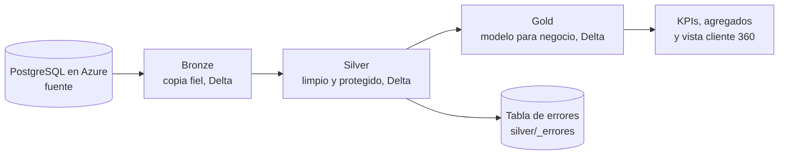

# FinBank Data Pipeline

## 1. Decisiones iniciales

- **Sector elegido:** Escenario A, Banca y Servicios Financieros (FinBank S.A.).
- **Plataforma cloud:** Microsoft Azure.
- **Por qué este sector:** el escenario de banca junta casi todo lo que pide la prueba: una regla de clasificación (los rangos de mora), cálculos sobre ventanas de tiempo (el promedio móvil de 30 días para detectar fraude y el CLTV de 12 meses), reportes agregados para regulación y datos muy sensibles que hay que proteger. Además, sus reglas están bien definidas en el documento, así que pude comprobar cada resultado contra una cifra esperada.
- **Por qué Azure:** Databricks y ADLS Gen2 se integran bien con el resto de Azure, y es la plataforma con la que trabaja DATAKNOW, así que me sirve para aprender lo que usaría en el trabajo.

## 2. Arquitectura



| Pieza | Servicio | Para qué sirve |
|---|---|---|
| Fuente | Azure Database for PostgreSQL Flexible Server 16 | Base transaccional de FinBank |
| Data lake | ADLS Gen2 con contenedores `bronze`, `silver` y `gold` | Arquitectura Medallón |
| Procesamiento | Azure Databricks, Runtime 18.3.9, un nodo `Standard_D4s_v7`, PySpark y Delta Lake | Transformaciones |
| Orquestación | Databricks Workflows (job `finbank-pipeline-diario`) | Horario, dependencias, reintentos y alertas |
| Secretos | Key Vault y secret scope de Databricks | Que no haya contraseñas en el código |
| Monitoreo | Log Analytics, Action Group y correos por SMTP | Auditoría y alertas |
| Infraestructura | Terraform (`azurerm`), estado en un Storage Account remoto | Crear todo con código |
| Permisos | Grupos de Entra ID con RBAC | Tres roles: ingeniero, analista y administrador |

## 3. Estructura del repositorio

- `/infra`: Terraform. `backend-dev.hcl` y `backend-prod.hcl` indican dónde se guarda el estado, `envs/` tiene las variables de cada entorno y `scripts/` el script que configura los secretos de Databricks.
- `/data-generation`: generador de datos sintéticos, carga a PostgreSQL y `config.yaml` con los parámetros.
- `/pipelines`: notebooks de Databricks. `00_common` es la caja de herramientas, `01_bronze`, `02_silver` y `03_gold` son las tres capas, `04_calidad` son las pruebas, `05_resumen` manda el correo diario y `06_catalogo` genera el catálogo de datos.
- `/orchestration`: definición del job de Databricks (`finbank_job.json`).
- `/docs`: diagrama ER, catálogo de datos, linaje y las evidencias en `docs/evidencias`.
- `CHANGELOG.md`: historial de cambios.

## 4. Entorno de ejecución

- Python 3.12, Windows 11 como sistema de desarrollo.
- Herramientas: Git, Docker Desktop, Terraform 1.6 o mayor, Azure CLI y Databricks CLI.
- Instalación de dependencias de Python:

```powershell
py -3.12 -m venv .venv
.venv\Scripts\Activate.ps1
pip install -r requirements.txt
```

Uso Python 3.12 porque con una versión más nueva (3.15) algunas librerías, como pyyaml, no tienen paquete ya compilado y obligan a compilarlas. Fue el primer problema que tuve.

Todos los comandos son de PowerShell. Cuando un argumento lleva punto (`-var-file=envs/dev.tfvars`) va entre comillas, porque si no PowerShell lo parte en dos.

## 5. Supuestos

- Los datos de FinBank se modelan para Colombia (COP, Superintendencia Financiera, PSE, ACH), con 12 ciudades principales identificadas con código DANE.
- `comision_admin` está en COP: mensual para créditos y ahorro, por transacción para productos transaccionales.
- Las obligaciones se desembolsan desde octubre de 2024 para que haya cartera con historia. Los movimientos y comisiones cubren de octubre de 2025 a septiembre de 2026, y la fecha de corte de la cartera es el 30 de septiembre de 2026.
- Se generan 7 patrones de anomalías, registrados en `data/raw/anomalies_log.json`: fechas de nacimiento futuras, estados inconsistentes, fechas de movimiento fuera de rango, montos negativos, transacciones duplicadas, saldos mayores al desembolso y días de mora negativos.
- Los nulos en `id_dispositivo` incluyen un nulo estructural: las operaciones por corresponsal no tienen dispositivo.
- Convierto COP a USD con una TRM fija de 4,000.
- La provisión se estima con porcentajes simplificados sobre el saldo: A 1 %, B 3.2 %, C 20 %, D 50 % y E 100 %. En producción se usarían los de la tabla de la Superintendencia.
- La fuente no trae intereses cobrados ni costo de incentivos. Los intereses del CLTV son una estimación (monto desembolsado por tasa mensual) y no resto incentivos.
- Horario hábil: lunes a viernes de 8:00 a 17:59.
- La zona horaria del job es `America/Bogota`, porque el negocio modelado es colombiano. El documento pide el huso horario local del proyecto sin precisar cuál.

## 6. Fase 1: generación de datos y carga

```powershell
# 1. Levantar PostgreSQL local (copiar data-generation/.env.example a .env y poner una contraseña)
cd data-generation
docker compose up -d
cd ..

# 2. Generar los datos sintéticos (semilla fija: el resultado es reproducible)
python data-generation/generate_data.py

# 3. Crear el esquema y cargar la base local
python data-generation/load_to_postgres.py
```

- Parámetros de generación: `data-generation/config.yaml`.
- Diagrama ER: `docs/er_diagram.md`.
- Conteos de la carga local: `docs/evidencia_fase1_conteos_local.txt`. Los de la base en Azure están en `docs/evidencia_fase1_conteos.txt`.

## 7. Fase 2: infraestructura con Terraform

Este paso se hace una vez por cuenta de Azure. Cambia los textos en mayúsculas por tus valores.

```powershell
# Proveedores de recursos que usa el proyecto
az provider register --namespace Microsoft.Storage
az provider register --namespace Microsoft.KeyVault
az provider register --namespace Microsoft.OperationalInsights
az provider register --namespace Microsoft.Insights
az provider register --namespace Microsoft.Databricks
az provider register --namespace Microsoft.DBforPostgreSQL

# Grupos de Entra ID (los tres roles)
az ad group create --display-name finbank-engineers --mail-nickname finbank-engineers
az ad group create --display-name finbank-analysts --mail-nickname finbank-analysts
az ad group create --display-name finbank-admins --mail-nickname finbank-admins
az ad group member add --group finbank-engineers --member-id (az ad signed-in-user show --query id -o tsv)
az ad group member add --group finbank-admins --member-id (az ad signed-in-user show --query id -o tsv)

# Almacenamiento del estado de Terraform (se crea a mano porque Terraform lo necesita antes de empezar)
az group create -n rg-tfstate -l eastus2
az storage account create -n TU_CUENTA_DE_ESTADO -g rg-tfstate -l eastus2 --sku Standard_LRS --min-tls-version TLS1_2 --allow-blob-public-access false
az storage account blob-service-properties update --account-name TU_CUENTA_DE_ESTADO -g rg-tfstate --enable-versioning true
az role assignment create --assignee-object-id (az ad signed-in-user show --query id -o tsv) --assignee-principal-type User --role "Storage Blob Data Contributor" --scope (az storage account show -n TU_CUENTA_DE_ESTADO -g rg-tfstate --query id -o tsv)
az storage container create --account-name TU_CUENTA_DE_ESTADO -n tfstate --auth-mode login
```

Antes de desplegar hay que editar dos archivos:

- `infra/backend-dev.hcl`: poner el nombre de `TU_CUENTA_DE_ESTADO`.
- `infra/envs/dev.tfvars`: tu correo, tu IP pública (`Invoke-RestMethod https://api.ipify.org`) y los identificadores de los tres grupos (`az ad group show -g NOMBRE_DEL_GRUPO --query id -o tsv`).

```powershell
cd infra
terraform init "-backend-config=backend-dev.hcl"
terraform validate
terraform plan "-var-file=envs/dev.tfvars"
terraform apply "-var-file=envs/dev.tfvars"
cd ..
```

El `plan` debe mostrar 24 recursos por crear y ninguno por destruir. Para producción se usa `backend-prod.hcl` y `envs/prod.tfvars`, con `terraform init -reconfigure`.

Recursos que se crean: grupo de recursos, Storage Account con ADLS Gen2 y contenedores `bronze`, `silver` y `gold`, Key Vault con tres secretos, PostgreSQL Flexible Server con su base y reglas de firewall, Log Analytics, Action Group, configuración de diagnóstico del data lake, workspace de Databricks y las asignaciones de roles.

La región de PostgreSQL es una variable aparte (`pg_location`, por defecto `centralus`), porque en `eastus2` mi suscripción no ofrecía PostgreSQL 16.

### Cargar la base fuente en Azure

La contraseña de PostgreSQL la generó Terraform y está en Key Vault. Hay que pasarla a un archivo local, que Git ignora, sin mostrarla en pantalla:

```powershell
$KV  = terraform -chdir=infra output -raw key_vault_name
$PGH = terraform -chdir=infra output -raw pg_host
$PGP = az keyvault secret show --vault-name $KV --name pg-password --query value -o tsv
@"
POSTGRES_HOST=$PGH
POSTGRES_USER=finbankadmin
POSTGRES_PASSWORD=$PGP
POSTGRES_DB=finbank_source
POSTGRES_SSLMODE=require
"@ | Set-Content -Encoding ascii data-generation\.env.azure

$env:ENV_FILE = ".env.azure"
python data-generation\load_to_postgres.py
Remove-Item Env:ENV_FILE
```

## 8. Fase 3: pipeline Bronze, Silver y Gold

Primero hay que dejar los secretos en Databricks. El script los lee de Key Vault y pide por pantalla el correo de alertas y una contraseña de aplicación de Gmail (no la contraseña real):

```powershell
powershell -ExecutionPolicy Bypass -File infra\scripts\setup_databricks.ps1
```

Después se suben los notebooks y se crea un clúster de un nodo en Databricks (Runtime 18.3.9, `Standard_D4s_v7`, acceso de un solo usuario y apagado automático a los 10 minutos):

```powershell
$ME = (databricks current-user me | ConvertFrom-Json).userName
databricks workspace import-dir pipelines "/Workspace/Users/$ME/finbank" --overwrite
```

Cada vez que cambio un notebook en mi equipo hay que repetir `import-dir`, porque el job usa la copia que está en Databricks.

**Bronze** (`01_bronze`): copia la fuente tal cual en formato Delta, sin cambiar el esquema. Agrega tres columnas de auditoría (`_ingest_ts`, `_source_system`, `_batch_id`) y particiona por año, mes y día de ingesta. Las tres tablas pequeñas se copian completas y las tres grandes son incrementales: solo traen las filas cuya llave (`id_mov`, `id_oblig` o `id_comision`) es mayor a la última cargada. Cada corrida guarda en `gold/ops/run_log` las filas, el tamaño y la duración.

**Silver** (`02_silver`): quita duplicados exactos, estandariza valores, valida que los clientes y productos existan y manda lo que no cumple a `silver/_errores` con su motivo. Los nulos tienen una estrategia por columna. Protege los datos personales: el documento se guarda como hash SHA-256 con sal y los nombres quedan enmascarados. Calcula `ind_sospechoso` y deja un reporte de calidad por corrida en `gold/ops/dq_silver`.

**Gold** (`03_gold`): dimensiones (`dim_clientes`, `dim_productos`, `dim_geografia`, `dim_canal`), hechos (`fact_transacciones`, `fact_cartera`, `fact_rentabilidad_cliente`) y tres tablas para consumo (`kpi_cartera_diaria`, `agg_regulatorio_mensual`, `vista_cliente_360`).

**Calidad** (`04_calidad`): seis pruebas sobre Gold, con resultado guardado en `gold/ops/dq_gold`. Si alguna falla, el notebook termina en error.

Conteos que debe dar una corrida completa:

| Capa | Resultado |
|---|---|
| Bronze | 50 productos, 200 sucursales, 10,000 clientes, 505,000 movimientos, 30,000 obligaciones y 80,000 comisiones |
| Silver | 50, 200, 9,950, 492,538, 29,540 y 79,575 |
| Gold | `dim_clientes` 9,950, `dim_productos` 50, `dim_geografia` 12, `dim_canal` 4, `fact_transacciones` 492,538, `fact_cartera` 29,540, `fact_rentabilidad_cliente` 104,539, `kpi_cartera_diaria` 927, `agg_regulatorio_mensual` 13,572 y `vista_cliente_360` 9,950 |

Ejecutar el pipeline dos veces da los mismos conteos: Bronze solo agrega lo nuevo y Silver y Gold se vuelven a calcular completos desde la capa anterior.

## 9. Fase 4: orquestación

El job `finbank-pipeline-diario` está definido en `orchestration/finbank_job.json`. Para crearlo, hay que cambiar `TU_CORREO` por el usuario de Databricks y revisar que el runtime y el tipo de nodo existan en tu región. Si el CLI rechaza algún campo, se quita:

```powershell
databricks jobs create --json "@orchestration/finbank_job.json"
databricks jobs run-now ID_DEL_JOB
```

Tiene cinco tareas encadenadas: `bronze`, `silver`, `gold`, `calidad` y `resumen`. Cada una solo arranca si la anterior terminó bien.

| Requisito | Cómo está |
|---|---|
| Horario | Todos los días a las 02:00, zona `America/Bogota` (queda en pausa hasta que se active) |
| Reintentos | 3 reintentos por tarea, con 30 segundos de espera fija |
| Backoff exponencial | Databricks solo permite espera fija, así que el backoff (30, 60 y 120 segundos) lo hace el código de Bronze con el decorador `retry` |
| Tiempo máximo | 30 minutos en Bronze, 40 en Silver y Gold, 20 en calidad y 10 en el resumen |
| Alerta de fallo | Correo desde el pipeline (capa, tabla, hora y error) y correo de Databricks cuando la tarea agota sus reintentos |
| Alerta de volumen | Si las filas de una corrida difieren más de 30 % del promedio de las últimas 7, llega un aviso |
| Resumen diario | Correo con filas por capa, tiempo total, registros rechazados y pruebas fallidas |
| Monitoreo | Historial de ejecuciones en la pantalla del job |

Para provocar una falla y ver las alertas, se ejecuta el job con el parámetro `simular_error = si`. Eso hace fallar la ingesta de `tb_comisiones_log` y deja el error registrado en `gold/ops/errores_pipeline`.

## 10. Fase 5: gobierno, seguridad y calidad

**Roles.** Son tres grupos de Entra ID, asignados con Terraform:

| Grupo | Permiso | Dónde |
|---|---|---|
| `finbank-engineers` | Lectura y escritura de datos | Todo el data lake |
| `finbank-analysts` | Solo lectura | Solo el contenedor `gold` |
| `finbank-admins` | Propietario | El grupo de recursos |

Para comprobarlo creé un usuario de prueba en el grupo de analistas. Puede leer `gold` y recibe acceso denegado en `silver` y `bronze`.

**Auditoría.** El data lake manda sus registros de lectura, escritura y borrado a Log Analytics. Con la tabla `StorageBlobLogs` se ve quién accedió, a qué contenedor, cuándo y con qué resultado. Los accesos del pipeline aparecen con la llave de la cuenta, sin nombre de persona.

**Datos personales.** Desde Silver, el documento es un hash con sal y los nombres están enmascarados. El documento original no existe en Silver ni en Gold.

**Secretos.** Las contraseñas las genera Terraform y viven en Key Vault. Databricks las lee de un secret scope y el código nunca las tiene escritas.

**Documentación:** `docs/catalogo_datos.md` (campos, tipos, origen y sensibilidad), `docs/linaje.md` (tres campos calculados) y `CHANGELOG.md`.

## 11. Decisiones técnicas

| Decisión | Por qué |
|---|---|
| Terraform | Describe la infraestructura en archivos que se pueden revisar y repetir, en vez de hacerla con clics |
| Estado de Terraform en un Storage Account | Contiene datos de la infraestructura y no debe estar en Git |
| Delta Lake en las tres capas | Da transacciones y historial de versiones sobre archivos Parquet |
| Bronze incremental por llave, no por fecha | La fuente trae fechas inválidas a propósito (por ejemplo del año 2029) y una fecha como marca de agua se habría saltado datos |
| Silver y Gold se recalculan completos | Es simple y siempre da el mismo resultado. Con volúmenes mucho mayores usaría `MERGE` |
| Databricks Workflows como orquestador | Está en la lista válida, maneja dependencias, horario y reintentos, y no tengo que pagar un Airflow aparte |
| PostgreSQL en Azure | Databricks corre en la nube y no puede llegar al Docker de mi equipo |
| Hash con sal para el documento | No se puede revertir, pero permite cruzar tablas por documento sin mostrarlo |
| Pruebas de calidad propias en PySpark | Cumplo las cinco pruebas sin agregar otra herramienta |
| Tabla de errores en vez de borrar | Lo que se rechaza queda con su motivo y se puede revisar |

## 12. Problemas que tuve y cómo los resolví

- **Python 3.15:** pyyaml no instalaba por falta de paquete compilado. Usé Python 3.12.
- **Proveedores de recursos:** al crear la primera cuenta de almacenamiento, Azure dijo que no encontraba la suscripción. Lo resolví registrando los proveedores de recursos.
- **PostgreSQL en `eastus2`:** esa región no ofrecía PostgreSQL 16 en mi suscripción. Le puse a PostgreSQL su propia región con una variable, sin mover lo demás.
- **Clúster sin capacidad:** `Standard_DS3_v2` no tenía capacidad en `eastus2`. Usé `Standard_D4s_v7`, que mi suscripción sí permitía, y el clúster tardó en arrancar.
- **Notebook cortado al pegarlo:** `00_common` quedó incompleto y Databricks dio un error de sintaxis. Desde entonces compruebo cada archivo con `python -m py_compile` antes de subirlo.

## 13. Limitaciones y mejoras

- Databricks lee el data lake con la llave de la cuenta. Lo mejor sería una identidad administrada (Access Connector con Unity Catalog), sin llaves y con registro por identidad.
- PostgreSQL es accesible por internet con reglas de firewall. En producción usaría una red privada.
- La alerta de volumen compara contra el promedio de lo ingerido y con esta fuente, que no cambia, avisa en cada corrida. Sería mejor compararla con el volumen que tiene la fuente.
- La regla de fraude es estadística y simple. La mejoraría con canal, horario y frecuencia diaria del cliente.
- Cada corrida del job espera varios minutos a que Azure entregue la máquina. Un pool de máquinas lo reduciría.
- La lectura de PostgreSQL usa una sola conexión. Se puede paralelizar por rangos de llave.
- PostgreSQL y Databricks están en regiones distintas porque mi suscripción no permitía PostgreSQL 16 en la región principal. En producción irían en la misma región, para evitar el costo de transferencia y la latencia.
- Faltan CI/CD con GitHub Actions, dbt o Great Expectations para las pruebas, y linaje automático con OpenLineage.

